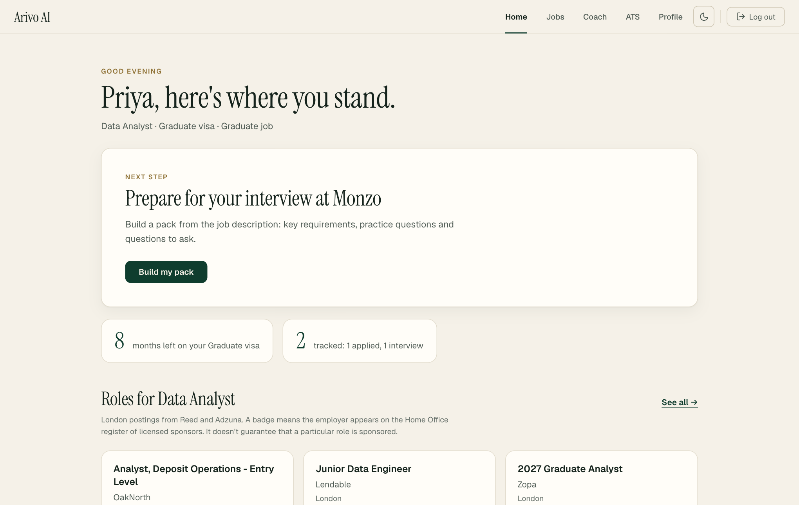
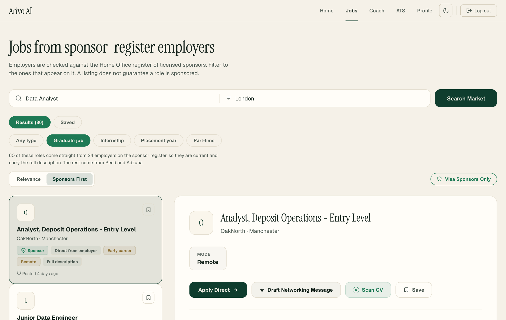
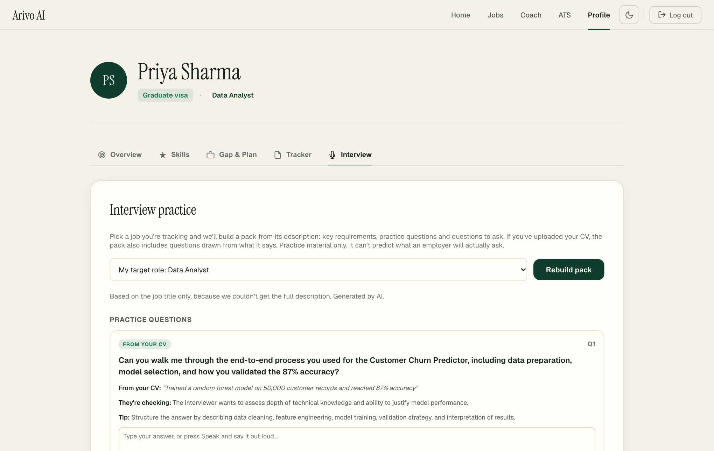
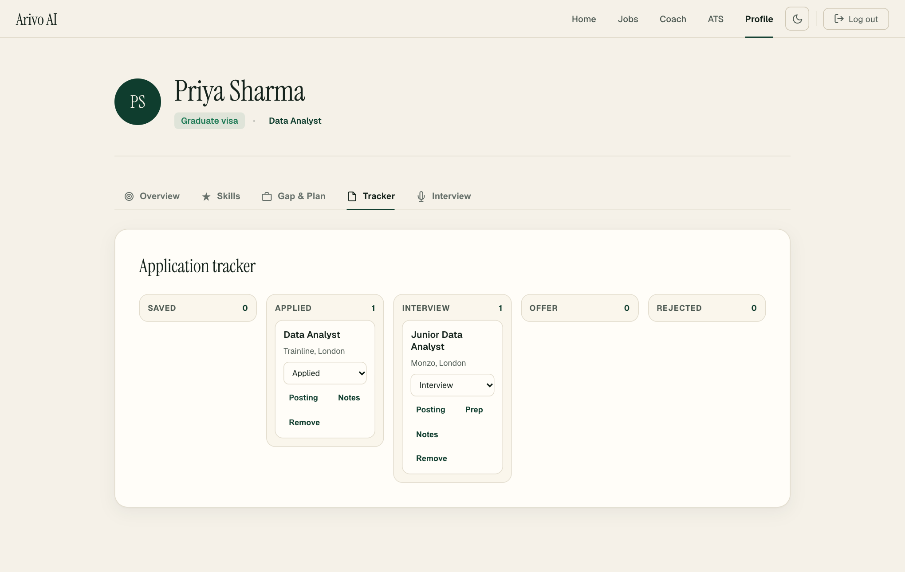
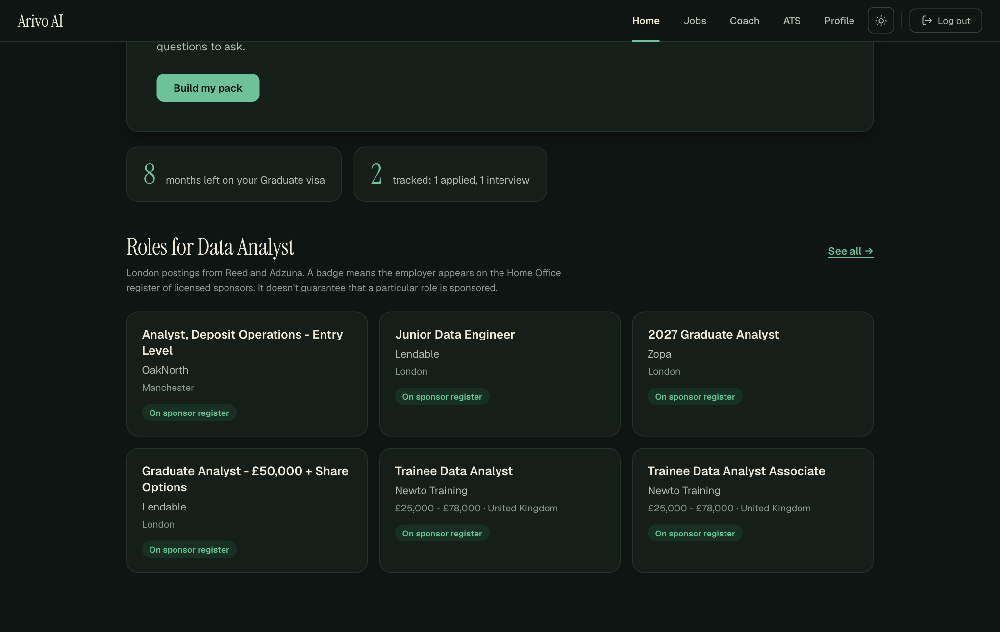
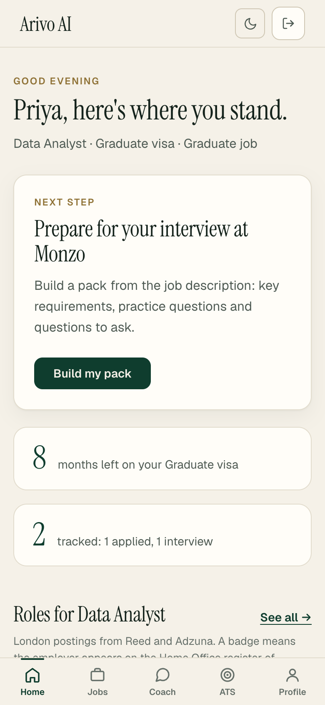
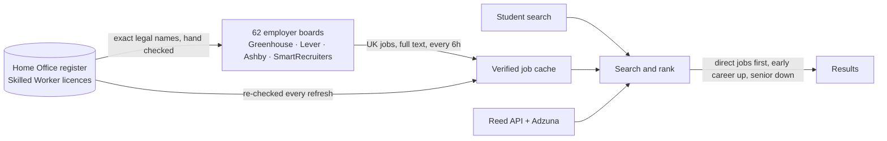
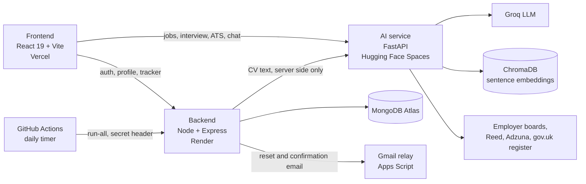

# Arivo AI

**Job search for international students in the UK, built around the one question generic job boards can't answer: can this employer legally hire me?**

[](https://github.com/Akshar246/arivo-ai/actions/workflows/ci.yml)


**[Open the live app](https://arivo-ai-xi.vercel.app)** · [Backend API](https://arivo-backend-vp35.onrender.com) · [AI service](https://itsakshar-arivo-ai.hf.space) · [LinkedIn](https://linkedin.com/in/akshar-chanchlani)

> The backend sleeps on its free host after 15 idle minutes, so the first request can take 30 to 50 seconds. After that it is quick.



---

## The 30 second version

- **The problem.** An international graduate on a Graduate visa has a clock running. Most job boards cannot say whether an employer holds a Skilled Worker licence, so students check the Home Office register by hand, one listing at a time.
- **What I built.** A full stack product, deployed on three services, that searches jobs from employers verified against the live Home Office register, reads each posting in full, and guides the student from CV to interview.
- **What is different.** ATS checkers, interview trackers and skill gap tools are common. Connecting the student's visa situation to the job search is not. Everything here is built on that.
- **How I work.** Every claim on screen has to be provable. If the backend cannot support a number, it does not ship. More on that below.

## What a student gets

| | |
|---|---|
| **Jobs from verified sponsors** | Up to 80 results per search. Roles taken straight from the career pages of employers whose licence is checked against the live register come first. Reed and Adzuna fill in the rest. |
| **A dashboard that says what to do next** | One next step, worked out from the student's real profile: upload a CV, run the skill comparison, check the CV against a job, save a role, or prepare for an interview that is booked. Months left on their visa and tracker counts sit beside it. |
| **A visa salary check on every job** | Compares the published salary with the Skilled Worker figures for the student's own visa type: clears £41,700, may qualify on the graduate route (70% of the going rate, from £33,400), range crosses the minimum, or below. It says what it cannot confirm and links its gov.uk source. When no salary is published it offers a ready message to ask the employer. |
| **A Sponsorship Scout** (opt-in) | Checks for new roles from register employers that fit the student's target role and skills, reads each posting for what it says about sponsorship and quotes the exact sentence, skips roles that say they can't sponsor, and emails a short list weekly or daily. Every pick shows its evidence. |
| **Full job pages** | Full descriptions, which of the student's own skills the posting names, salary when published, and honest labels such as "Early career" and "Direct from employer". |
| **Interview practice** | A pack for each tracked job (key requirements, practice questions, questions to ask), voice answers with pace and filler word stats, and feedback that reads the answer the way a UK interviewer would. |
| **Questions drawn from the student's own CV** | Each one quotes the line of the CV it came from. See the engineering notes below for why that matters. |
| **ATS check with an International Student Lens** | Scores a CV the way applicant tracking software parses it, and flags conventions from other countries, such as a photo or date of birth, that quietly fail UK screening. |
| **Application tracker** | Saved, applied, interview, offer, rejected, with notes and a stored interview pack per role. |
| **Skill gap plan** | The student's CV skills against current London postings for their target role, with a learning plan. |
| **Privacy and control** | A plain-English privacy policy and terms (no sign-in needed), "Download my data" for a full copy of what is held about you, an in-app feedback form that goes straight to me, account deletion that removes everything, and an opt-in Scout with one-click unsubscribe. |
| **Light and dark themes** | One design system with shared tokens, tested at phone and desktop widths. |

<table>
<tr>
<td width="50%"><br><sub>Jobs, with the direct-from-employer and early career labels</sub></td>
<td width="50%"><br><sub>Interview questions that quote the student's CV</sub></td>
</tr>
<tr>
<td><br><sub>Application tracker</sub></td>
<td><br><sub>Dark mode</sub></td>
</tr>
</table>

<p align="center"><br><sub>The same dashboard on a phone</sub></p>

---

## How the job search works

General job boards give a thin, repetitive slice of the market, and the employer name on a listing often does not match the legal name on the Home Office register. So the search starts from the employers instead.



- **Verified, not guessed.** Each employer is listed with its exact register entry, for example Monzo as `monzo bank ltd`. On every refresh the entry is looked up in the live register. An employer that falls off the register disappears from results.
- **Numbers at the time of writing (6 October 2026).** About 122,000 organisations hold a Skilled Worker licence. 62 employers publish UK roles through the supported boards, 1,764 UK jobs in total, each with the full description. A search for "Data Analyst" returns 80 jobs, 60 of them direct from 24 employers. Before this change a search returned about 16.
- **Ranking for students.** A seniority label is read from the job title. Early career roles rank higher, Senior, Lead and Principal roles rank lower, and a phrase match counts, so "product manager" no longer ranks "product analytics manager" first.
- **A bug I found along the way.** The register lists religious, sports, creative and charity worker licences too. My original loader counted all of them, which overstated who can sponsor a graduate job by about 5,300 organisations. It now counts only the Skilled Worker route.

## Rules I built it by

These are in the code, not just the README.

1. **Only claim what can be proven.** Early drafts had plausible placeholder stats and a fake progress tracker. I removed them. A badge says "On the register" because a register lookup said so, and the page says in plain words that this does not guarantee a particular role is sponsored.
2. **Ground the AI, then check it.** Models invent things. Wherever a model's output is shown as fact about the student, the code verifies it against the source. See the CV questions below.
3. **Do not circumvent.** Adzuna's `/land/ad/` links block automated readers. I did not work around that. The app shows a clear "preview only" notice, and recovers the full text through Reed's official API when the same role is listed there.
4. **Guidance, not advice.** Immigration advice is a regulated activity in the UK. Arivo gives information with sources and tells students to confirm with their university's international advisers.

## Engineering highlights

**Grounded CV interview questions.** The model must return, with each question, an exact quote from the CV it is based on. The service then checks that the quote really appears in the CV, ignoring line breaks and bullet characters, and drops any question whose quote does not. The prompt also forbids questions about age, nationality, family, health and similar topics. The check is a small pure function with its own tests, including a made-up quote that must be rejected. The CV text itself is read on the server and never sent to the browser.

**Employer matching that errs on the safe side.** A wrong "on the register" badge is the worst mistake this product can make, so I measured the matching instead of trusting it. On 346 real employer names from Reed and Adzuna, my first rule flagged 120 as sponsors, and reading every match showed about a third were wrong: the rule treated a name as matching if either contained the other, and the register has tiny entries like "alt" that sit inside ordinary words such as "healthcare". A placeholder employer called "Unknown" was flagged too. The replacement normalises names (legal endings, "t/a" aliases), matches only when two names are equal or differ by generic words like "Group" or "Holdings", and never matches on a fragment. It flags 83, I read every change, and it is faster (about 0.4 seconds to index 122,000 names, then milliseconds). The cost is honest: real sponsors whose register entry carries a region word, such as "Starbucks EMEA", now show as "not confirmed", which is the safe mistake.

**Reading postings for what they say about sponsorship.** The Scout finds the sentence in a posting that mentions sponsorship with plain patterns, not a model's guess, so every result is a quote the student can check. "We are unable to offer visa sponsorship" is a no. "Sponsorship is available" is an offer. Anything unclear stays "unclear", because silence is not a no. I tested it against about 1,770 real postings and read every distinct quote it found, which exposed three mislabels I would never have written tests for: "would not require sponsorship" is not an offer, "transfer of existing sponsorship" does not help a new graduate, and "we cannot offer relocation but we can sponsor" is two statements in one sentence. All three are now fixed and tested. At the time of writing, of those postings about 80 said they could not sponsor, about 85 said they could, and the rest said nothing.

**A security audit, not just good intentions.** I audited the whole stack and fixed what I found, in order of severity. The AI service had no authentication at all, so anyone could spend the model and job-API quotas, and one endpoint would fetch any URL it was given (I proved it tried to reach the cloud metadata address). It now needs a signed login token or a service key, is rate limited per caller, only fetches HTTPS pages from the job sites with every redirect re-checked, and caps every input. A leftover sign-in path accepted a login token from the address bar, which would let an attacker sign a victim into the attacker's account, so it is gone along with unused Google and LinkedIn code. Uploaded CVs were only deleted on success, and a 6 MB file returned a 500; both fixed. Dependencies went from 2 critical and 11 high advisories to none that have a fix, mostly by removing packages we never used. A guard test fails if a future route is added without authentication. The details, the safe rollout order and the risks I'm accepting are in [`docs/security.md`](docs/security.md).

**Authentication that holds up.** Passwords are hashed with bcrypt. Password reset and email confirmation use random one-time tokens, of which only the SHA-256 hash is stored, so a leaked database cannot be used to reset anyone's account. The reset form answers identically whether or not an address exists, so it cannot be used to find out who has an account. Each sensitive route has its own rate limit. After a reset, every session issued before it is rejected. Accounts and all their data can be deleted by the student.

**Email at zero cost.** Resend only delivers to arbitrary addresses once a domain is verified, and Render's free plan blocks SMTP. So reset and confirmation emails go out through a small Google Apps Script web app that sends from a Gmail account, guarded by a shared secret. The mailer falls back to Resend when it is configured. Setup is in [`docs/mail-relay.md`](docs/mail-relay.md).

**A concurrency bug worth remembering.** Two searches at once crashed the AI service. The cause was the embedding model running on Apple's GPU backend, which is not thread safe. Pinning embeddings to the CPU fixed it, and I added request timeouts so a slow upstream cannot hang a request.

**Honest handling of messy data.** Salaries published as "£0 - £55K" are shown as "Up to £55K". Job descriptions arrive as double escaped HTML from some providers and are converted to readable paragraphs with bullets. One broken employer board never takes the rest down.

**One design system.** Every page uses the same colour tokens, including a dark theme. A scan for unreadable text found nothing on the main pages in either theme (the ATS results screen needs a real CV scan, so it was not covered), and the app is tested at phone width.

## Architecture

Three services deployed separately and talking over REST.



| Layer | Stack |
|---|---|
| Frontend | React 19, Vite, plain CSS with design tokens, no UI framework |
| Backend | Node.js, Express 5, Mongoose, JWT, bcrypt, in-memory rate limiter |
| AI service | FastAPI, LangChain, ChromaDB, Groq (`openai/gpt-oss-120b`), `all-MiniLM-L6-v2` embeddings on CPU, pdfplumber, scikit-learn |
| Data | Home Office register of licensed sponsors (live CSV, cached daily), employer job boards, Reed API, Adzuna API |
| Delivery | Docker Compose for local, Vercel, Render and Hugging Face Spaces in production, GitHub Actions for tests |

More detail is in [`docs/architecture.md`](docs/architecture.md).

## Quality

Every push and pull request runs a pipeline ([`ci.yml`](.github/workflows/ci.yml)) with no real API keys, so it is safe for forks too:

- **Frontend:** lint (zero errors), production build, dependency audit.
- **Backend:** every file parses, **26 tests**, dependency audit. The tests cover the behaviours that matter for security: sessions stop working after a password reset, forged, expired and unsigned tokens are refused, the scheduler endpoint rejects a wrong or short secret, the unsubscribe link cannot be made from a login token, rate limits, and HTML in names cannot inject markup into emails.
- **AI service:** **95 tests**, dependency audit. They cover sponsor matching, the quote check behind the CV questions, employer board parsing for all four providers, register verification, ranking, the visa salary rules, the Scout's wording reader, employer name matching, and the security layer (authentication, rate limits, request-forgery protection, input limits, CORS). One test fails if a new route is ever added without authentication.
- **Secret scan** over the full git history, and **weekly dependency update pull requests** from Dependabot.

I check that tests can fail, not only pass: for example, breaking the "session before a password reset" check makes exactly the two tests that cover it fail.

What is not covered yet: automated tests for the React screens. They are checked by hand in a real browser, and end-to-end browser tests are on the list.

## Roadmap

**Shipped**

- [x] Sign up, onboarding (visa type, end date, what they are looking for), remember me, account deletion
- [x] Password reset and email confirmation
- [x] Application tracker, interview packs, voice practice, UK style feedback, questions from the CV
- [x] Jobs from verified sponsor employers, early career ranking, full descriptions
- [x] One design system with light and dark themes
- [x] Privacy policy, terms of use and a data download, written from what the code actually stores
- [x] In-app feedback and a plan for testing with real students ([`docs/user-research.md`](docs/user-research.md))
- [x] Security audit and hardening of all three services ([`docs/security.md`](docs/security.md))
- [x] Stricter employer name matching, measured on real data
- [x] Sponsorship Scout: daily scan, posting-wording evidence, digest email with one-click unsubscribe, dashboard panel
- [x] A first visa salary check on every job (salary against the published Skilled Worker figures, with the rule date and source shown)

**Next, in this order**

1. **Sharper sponsorship check.** The first version compares salary with the fixed figures. The real test also uses the going rate for the job's occupation code, which can be higher. Mapping a job title to its government occupation code reliably is the next hard problem. Only about 6% of direct postings publish a salary, so "salary not published" is common and labelled as such.
2. **Visa runway and cost planner.** Months left turned into milestones, with a plain calculator for visa fees built from published figures.
3. **Application helper**, then a **live mock interviewer** that asks follow-up questions.
4. **Wider coverage.** Banks, consultancies, retailers and the NHS publish through systems the current connectors do not read. Adding them is the biggest gap in the job list.

## Known limitations

- Direct employer jobs cover tech, fintech and AI employers today. Other sectors come from Reed and Adzuna only.
- Being on the register does not mean a particular role is sponsored. The product says so wherever it shows a badge.
- Generated questions, feedback and summaries come from a language model. They are practice material, not predictions, and are labelled as AI generated.
- Matching of Reed and Adzuna company names to the register is deliberately strict. Some real sponsors show as "not confirmed" when their register entry carries a region word or a different legal name. It never claims a sponsor it can't match.
- The Scout reads the full posting for direct employer jobs. For Reed and Adzuna it often has only a preview, and says so, because a "no sponsorship" line further down would be missed.
- The free hosting tiers are slow to wake. The Gmail relay allows roughly 100 emails a day, which is enough for now.

## Run it locally

```bash
git clone https://github.com/Akshar246/arivo-ai.git
cd arivo-ai
cp .env.example .env        # then fill in your own keys
docker compose up --build
```

Frontend on `:3000`, backend on `:5001`, AI service on `:8000`. Without Docker, run each service from its own folder (`npm run dev`, `node server.js`, `uvicorn main:app --port 8000`) and set `VITE_API_URL` and `VITE_AI_URL` for the frontend.

| Variable | Used by | Purpose |
|---|---|---|
| `MONGODB_URI`, `JWT_SECRET` | backend | Database and session signing |
| `GROQ_API_KEY` | AI service | Language model |
| `REED_API_KEY`, `ADZUNA_APP_ID`, `ADZUNA_API_KEY` | AI service | Job sources |
| `AI_SERVICE_URL` | backend | Where the backend reaches the AI service |
| `FRONTEND_URL` | backend | Used to build the links in emails |
| `AI_SERVICE_KEY` | backend and AI service | Shared key the backend uses to call the AI service |
| `JWT_SECRET` | backend and AI service | Signs sessions (32+ characters). Setting it on the AI service switches its authentication on |
| `ALLOWED_ORIGINS` | AI service | Websites allowed to call it from a browser |
| `CRON_SECRET`, `BACKEND_URL` | backend | Lets a scheduler start the daily Scout run; public address for unsubscribe links |
| `MAIL_RELAY_URL`, `MAIL_RELAY_SECRET` | backend | Free email through Gmail ([setup](docs/mail-relay.md)) |
| `RESEND_API_KEY`, `MAIL_FROM` | backend | Optional alternative once a domain is verified |

With no email settings, reset and confirmation links print in the backend log during development. No secrets are committed; see `.env.example`.

Tests: `cd ai-service && pip install pytest -r requirements.docker.txt && pytest`.

## Where to look in the code

| If you want to see | Open |
|---|---|
| Employer board connectors, register check, ranking | [`ai-service/sponsor_boards.py`](ai-service/sponsor_boards.py) and its tests |
| The AI service security layer and its tests | [`ai-service/security.py`](ai-service/security.py), [`docs/security.md`](docs/security.md) |
| Employer name matching and its tests | [`ai-service/sponsor_match.py`](ai-service/sponsor_match.py) |
| The Scout (wording reader, picking) and its tests | [`ai-service/scout.py`](ai-service/scout.py), [`backend/services/scoutService.js`](backend/services/scoutService.js) |
| The visa salary rules and their tests | [`ai-service/visa_rules.py`](ai-service/visa_rules.py) |
| The grounded CV question endpoint | `ai-service/main.py` (`/interview/cv-questions`) |
| Auth, reset, confirmation, rate limits | [`backend/controllers/authController.js`](backend/controllers/authController.js), [`backend/utils/mailer.js`](backend/utils/mailer.js) |
| The design system and dark theme | [`frontend/src/styles/ivory.css`](frontend/src/styles/ivory.css) |
| The dashboard's next step logic | [`frontend/src/pages/Dashboard.jsx`](frontend/src/pages/Dashboard.jsx) |

## About

Built by **Akshar Chanchlani**, an international student. MSc Artificial Intelligence at Brunel University London, BSc Computer Science at Middlesex University. I got tired of checking the sponsor register by hand, one listing at a time, so I built the tool I wanted.

[LinkedIn](https://linkedin.com/in/akshar-chanchlani) · [aksharchanchlani7006@gmail.com](mailto:aksharchanchlani7006@gmail.com)

## License

MIT, see [LICENSE](./LICENSE).
